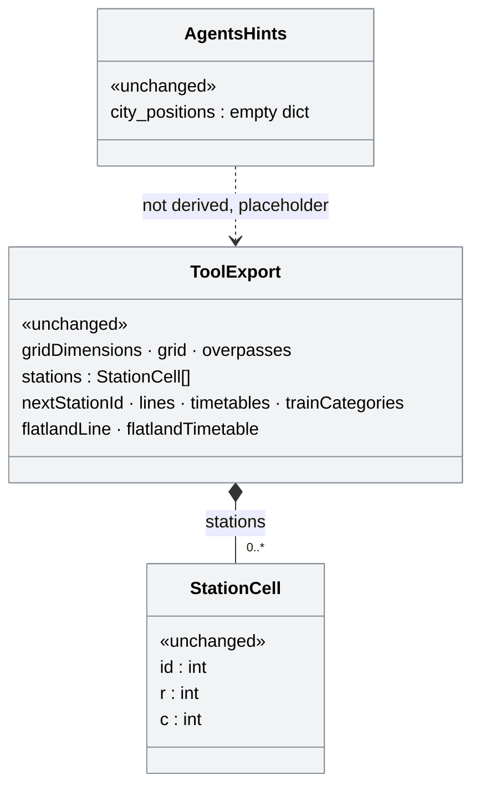
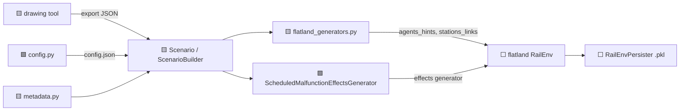
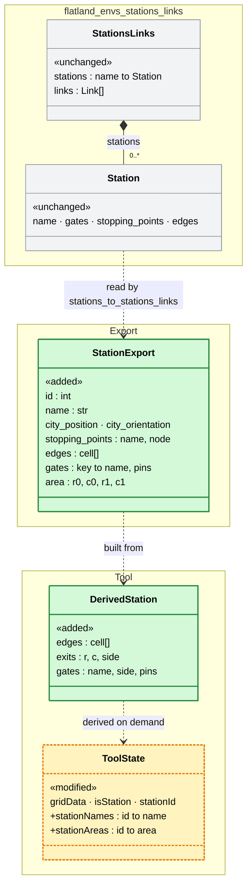
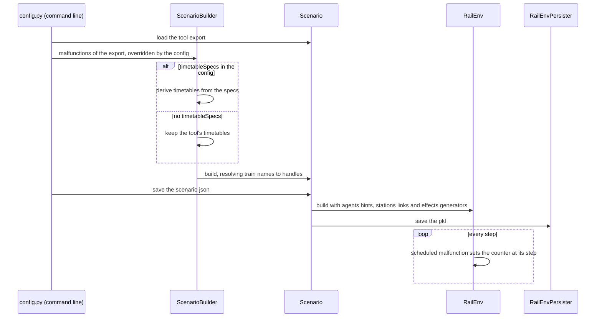

# Export stations as Flatland stations and links, and build scenarios with scheduled malfunctions (PR #39)

> **Status:** plan of 2026-11-11, written after the fact: steps S-1–S-11, S-13–S-17, S-20 and S-21 are
> built; S-12, S-18 and S-19 are open. Based on `main` `2e20db2`. No issue; branch `feature/grouped-station-format`, PR
> [#39](https://github.com/flatland-association/flatland-scenarios/pull/39) at `150782e`, local commits up to `44834fc`. No open questions (§9.1).
>
> **Why:** environments drawn in the Flatland Environment Drawing Tool had no stations in Flatland
> (`agents_hints` was an empty placeholder, `env.stations_links` was `None`), and experiments needed a train broken
> at a known step. Now stations reach Flatland in its stations and links model, and one command builds a scenario
> `.json` and `.pkl` from a drawing and a `config.json`.

## 1. Introduction and goals

*What the change is for: the requirements, the qualities that matter, who has a stake, and what it leaves out.*

### 1.1 Requirements overview (functional requirements)

*The issue's text and the numbered requirements the rest of the plan refers to.*

There is no issue. The requirements come from the PR description (as of `150782e`) and the review thread on
`flatland_generators.py` ("Why not use only the new format: stations_links?", 2026-10-28).

Requirements:

- **REQ-1** The drawing tool exports one entry per station, in the vocabulary of Flatland's
  [stations and links](https://flatland-association.github.io/flatland-book/environment/environment/stations_links.html)
  (name, stopping points, edges, gates with pins, fully qualified names), plus `city_position` and
  `city_orientation`.
- **REQ-2** The rail generator built from an export returns `agents_hints` (`city_positions`, `city_orientations`,
  `train_stations`) and `stations_links`, so `env.stations_links` is set and persisted in the `.pkl`.
- **REQ-3** Stations can be named in the tool; a station area (rectangle) determines the station's tracks, gates and pins.
- **REQ-4** One command builds a scenario `.json` and `.pkl` from a tool export and a `config.json` with optional
  `timetableSpecs`, `malfunctions` (`breakdown`, `departure`, `scheduled`) and `seed`.
- **REQ-5** A scheduled malfunction breaks one train, named by timetable name or handle, during exactly the steps
  `[step, step + duration)`; unknown or ambiguous names and out-of-range handles stop the build; an overlap with
  an ongoing malfunction is skipped with a warning.
- **REQ-6** Older exports keep working: the `station_cells` format and the flat per-cell format of `main` (F-1)
  still import in the tool and build the same environment.

### 1.2 Quality goals (non-functional requirements)

*The few qualities the design must reach, each with a concrete scenario.*

| ID | Priority | Quality goal | Scenario |
|---|---|---|---|
| NFR-1 | 1 | Compatibility | `competitions/competition_2026` (flat per-cell format) still generates its `.pkl`s; its tests pass. |
| NFR-2 | 2 | Reproducibility | The same `config.json` with only scheduled malfunctions gives the same broken steps on every run and after loading the `.pkl`. |
| NFR-3 | 3 | Consistency with Flatland | `env.stations_links` of a drawn environment has the same shape and naming as one from `sparse_rail_generator`. |

### 1.3 Stakeholders

*Who asks for the change, decides on it, reviews it or works with the result, and what they expect.*

| Role | Name | Expectations |
|---|---|---|
| Author | Manuel Meyer (`CleverManu`) | Stations and scheduled malfunctions available for experiments. |
| Reviewer | `chenkins` | Stations in Flatland's stations and links model, not a parallel format. |
| Users of `env.stations_links` | flatland-hmi | Station names, stopping points, gates and pins of drawn environments. |
| Competition maintainers | `competitions/` | Generation of the competition scenarios keeps working. |
| flatland-ui-hub | [flatland-ui-hub#164](https://github.com/flatland-association/flatland-ui-hub/pull/164) | Experiment scenarios keep loading; station names in the ZWL and on the map, train names by handle. |

### 1.4 Follow-ups (not in this PR)

*What this PR leaves out, why, and where it goes later.*

| Follow-up | Why not in this PR | From | Findings | Issue |
|---|---|---|---|---|
| Drawing tool: links and fibres between stations, complete pins checked when an area is saved, and gates split by the corridor rule (R-5), starting from S-19's one gate per side. | Needs the tool to follow tracks outward to other stations' pins; the tool switches to the exchange format first (Q-4). Drafted in flatland-book's logical-model plan: [`issue-flatland-scenarios-drawing-tool-gates.md`](https://github.com/flatland-association/flatland-book/blob/2f599ca/docs/plans/stations-links-logical-model/issue-flatland-scenarios-drawing-tool-gates.md). | Limitations, §2.2, Q-2 c), Q-2 revisited | - | - |
| Apply `seed` when the env is built. | Already so in the metadata pipeline; changes generated `.pkl`s. | Limitations | 6 | - |
| A drawing tool tab for malfunctions. | The `config.json` override covers it for now. | §4.5 | - | - |
| Move `ScheduledMalfunctionEffectsGenerator` to flatland-rl, so `.pkl`s load without `scenario_generator`. | Another repo; meanwhile [#40](https://github.com/flatland-association/flatland-scenarios/pull/40) stores it under flatland-rl's future class path, as flatland-ui-hub's `.pkl`s expect. | Limitations | 4 | [#40](https://github.com/flatland-association/flatland-scenarios/pull/40) |
| The exchange format: `Station` fields (`id`, `placement`, `area`), a JSON form with a schema, generic types for grid and graph, the drawing tool's export replaced by scenario documents with a converter for older exports, flatland-ui-hub's loss-free geography adapter. Patches for the station fields: [flatland-rl](https://github.com/flatland-association/flatland-rl/blob/f40d97c0/docs/plans/flatland-scenario-exchange-format/flatland-rl-station-fields.patch), [flatland-scenarios](https://github.com/flatland-association/flatland-rl/blob/f40d97c0/docs/plans/flatland-scenario-exchange-format/flatland-scenarios-station-fields.patch). | Out of scope (2026-11-11, Q-4): flatland-rl changes, then a pin bump here. Planned in flatland-rl's [exchange-format plan](https://github.com/flatland-association/flatland-rl/blob/f40d97c0/docs/plans/flatland-scenario-exchange-format.md) (PR [#572](https://github.com/flatland-association/flatland-rl/pull/572)): S-1, S-2, S-4 (flatland-rl), S-7, S-8 (this repo), S-9 (flatland-ui-hub). | Q-4, §5.2 | - | - |
| Tests for the drawing tool: export, import and a round trip (export, import, export) in a headless browser, on the example JSONs with drawn areas. | The repo has no JS test setup; CI runs only Python. | Q-3, S-18, S-19 | - | - |


## 2. Constraints

*What limits the design from outside: platform, organisation and conventions.*

| ID | Constraint | Kind | Explanation |
|---|---|---|---|
| C-1 | flatland-rl `v4.3.0` | technical | Pinned in `.github/workflows/checks.yml` (`flatland-rl-ref`); has `flatland.envs.stations_links`, `make_multi_effects_generator` and effects generator state in the `.pkl`. |
| C-2 | Python 3.10-3.13 | technical | CI matrix of `test-scenario-generator`. |
| C-3 | The drawing tool is one HTML file | technical | `flatland_environment_drawing_tool.html`, no build step; checked with `node --check` and by hand in a browser. |
| C-4 | `competitions/` stays untouched | organisational | Its scenarios are published; they keep the flat per-cell format. |
| C-5 | [flatland-ui-hub#164](https://github.com/flatland-association/flatland-ui-hub/pull/164) consumes this PR's output | organisational | Merged; its experiment scenarios (`backend/app/fixtures/plan-b/*/`) were built with this pipeline and are read by `app/core/experiment_scenarios.py`: the `.pkl` (`stations_links` stations and stopping points as names for the ZWL and the map, scheduled malfunctions by handle and class path) and `generator.json` (this PR's scenario `.json`: `gridDimensions`, `timetables[i].name` for handle `i`); `config.json` and `draw.json` are kept there but not read. Any change to these outputs must be made in flatland-ui-hub as well: regenerate its fixtures and adapt its readers. |
| C-6 | The export's structure stays as committed (`a462df3`) | organisational | Keys and JSON shape of the station export (`stopping_points` as `{name, node}`, `gates` as `{name, pins}`, `edges`, `area`, `city_position`, `city_orientation`) and of `agents_hints` do not change in this PR; later structural changes go to the [exchange-format plan](https://github.com/flatland-association/flatland-rl/blob/f40d97c0/docs/plans/flatland-scenario-exchange-format.md). The meaning is fixed in this PR before it reaches `main`: S-18 (one stopping point per track) and S-19 (one gate per side) change only values, and none of today's data (§8.2.1). |
| C-7 | No repo `AGENTS.md`/`CLAUDE.md` | conventions | Conventional Commits as in the git log. |

### 2.1 Limitations

*What the built code gets wrong or ignores, each with the TODO or issue that tracks it.*

Limitations (`stations_to_stations_links`'s docstring and the PR description's "Things reviewers should know"):

- `stations_links.links` is always empty (docstring: "Links are not captured yet").
- A station without an area has no gates, and its edges are its platform cells only (by design: the README says to draw an area).
- `city_orientation` is binary (1 = horizontal, 0 = vertical), not a direction 0-3 (`agents_hints` only; §5.2).
- `city_position` is in the export and in `agents_hints` while the env is built, but not in the env or the `.pkl`: `reset()` does not keep `agents_hints`, `RailEnvPersister` does not save it, and `Station` has no position (as for `sparse_rail_generator`). After S-18 it is no longer the middle stopping point for a platform longer than one cell. Not needed by Flatland's generators (they use only the number of cities); the exchange-format plan's `Station.placement.position` carries it (§1.4, Q-4).
- Stopping points are per platform cell, not per track, until S-18 (Q-1 decided b)).
- A side with several runs of pins has several gates (`E1`, `E2`, …), until S-19 (Q-2 decided b)).
- `seed` is stored on the scenario but not used to build the env (F-6).
- `breakdown` and `departure` use `ParamMalfunctionGen`, which adds 1 to the sampled duration; scheduled
  malfunctions last exactly `duration` steps.
- A `.pkl` with scheduled malfunctions needs `scenario_generator` importable to load (F-4).
- The tool does not read `gates`, `edges` or stopping point names back on import; it derives them again, so hand edits are lost on the next export (Q-3 decided a), README S-20).

### 2.2 Assumptions

*What must hold for the design to be correct, but is not checked in code.*

Not checked in code; they hold by construction of the drawing tool's export.

- Platform cells lie on straight track cells (the tool only allows stations there).
- The platform cells of one track are adjacent cells along one straight (S-18 groups them so).
- Agent handle `i` is built from timetable `i` (`ScenarioBuilder.add_timetable`), so train names resolve to handles.
- Station names are unique and contain no `.`, so the gate and pin names derived from them are unique across all
  stations, as `Link`s and `Fibre`s, which refer to them by name, require (flatland-book's "Logical Model" assumption).
  The tool checks this when a user names a station and refuses a JSON export with duplicates (`stationMetaProblems`);
  it does not check names on import or in the stations text area (F-19). Python does not check (F-8), nor does
  flatland's `StationsLinks`.
- Station areas do not overlap (the tool checks this), so stations stay disjoint as Flatland's model requires.
- Every track crossing a station's area boundary is connected to its platforms inside the area, so the pins
  `stationTracks` finds (flooding from the platform cells) are all of them, as flatland-book's [logical-model plan](https://github.com/flatland-association/flatland-book/blob/2f599ca/docs/plans/stations-links-logical-model.md) (PR [#45](https://github.com/flatland-association/flatland-book/pull/45)) requires (REQ-5 there). A track
  that crosses the area without such a connection (a bypass) gets no pin; not checked (follow-up §1.4). Holds on
  ECML2026 with areas reconstructed around its stations (the logical-model plan's §4.3).

## 3. Context and scope (checked 2026-11-11 on `main` `2e20db2`)

*The code on the base branch that the change works in, as it is before the change, and where the change stops.*

Context:

- `scenario_generator/flatland_environment_drawing_tool.html`: draws the grid, marks platform cells
  (`gridData[r][c].isStation`, `stationId`), and exports `stations` in the flat per-cell format, one `{id, r, c}` entry per platform
  cell. Stations could be renamed only by changing their id.
- `scenario_generator/flatland_integration/flatland_generators.py`: `rail_generator_from_grid_map(grid_map,
  level_free_positions)` returns the grid with `agents_hints = {"city_positions": {}}`; stations are ignored.
- `scenario_generator/model/scenario.py`: `Scenario` wraps the export; `to_rail_env()` builds a `RailEnv` with
  `ParamMalfunctionGen` for breakdowns and `IntermediateStopMalfunctionEffectsGenerator` for departure
  malfunctions. `ScenarioBuilder` derives timetables from `timetableSpecs`.
- `scenario_generator/model/metadata.py`: builds a set of scenarios from `metadata.json`
  (`malfunctionSpecs`, `departureMalfunctionSpecs`, `timetableSpecs`, `seed`).
- Neighbours: `competitions/competition_2026` (flat per-cell format, calls `metadata.py`), the six fixtures in
  `scenario_generator/examples/`, flatland-rl `RailEnvPersister`.

Data model: current export (`scenario_generator/examples/example_2/example_2_initial.json` on `main`):



Notation: [UML class diagram in Mermaid](https://mermaid.js.org/syntax/classDiagram.html). Grey: unchanged.

```json
"stations": [
  {"id": 1, "r": 9, "c": 28}, 
  {"id": 1, "r": 9, "c": 29}
]
```

Scope: the change rewrites the station export and import of the tool, adds the station conversion to
`flatland_generators.py`, adds scheduled malfunctions and the `config.json` pipeline, and migrates the six
fixtures. It only reads `competitions/` and `metadata.py`'s callers.

## 4. Solution strategy

*The fundamental choices and why, the rules the design follows, how it is verified, and the design of each part.*

| Quality goal | Scenario | Solution approach | Details |
|---|---|---|---|
| Compatibility | Flat per-cell and `station_cells` exports still build | Readers accept all three station formats; the export writes only the newest | §4.3, §4.4 |
| Reproducibility | Same broken steps every run | Scheduled malfunctions are an effects generator without randomness, persisted in the `.pkl` | §4.5 |
| Consistency with Flatland | Same shape as `sparse_rail_generator` | The export uses Flatland's `Station` fields and names; Python only reads them | §4.4, §5.2 |

### 4.1 Design principles

*The rules the design follows, each with its decision, the concepts it reuses instead of building new ones, and what
is not new on purpose.*

- **DP-1 The tool derives, Python reads.** Tracks, gates and pins come from the station area in the tool;
  `stations_to_stations_links` only copies them into Flatland's dataclasses. (review thread, 2026-11-04)
- **DP-2 Both `agents_hints` and `stations_links`.** Flatland's generators read `agents_hints`, and
  `sparse_rail_generator` emits both. (review thread, 2026-11-02)
- **DP-3 Ids stay internal, names are what Flatland sees.** Lines and timetables keep referring to station ids; the
  export names stations, stopping points, gates and pins by the station name, else the id.
- **DP-4 Readers stay compatible, the writer moves on.** The tool and Python read the flat per-cell, `station_cells` and
  stations_links exports; the tool writes only stations_links.
- **DP-5 The config overrides, never replaces.** `config.json`'s `malfunctions` overrides the export's key by key.
- **DP-6 Follow Flatland's conventions in the export.** One stopping point per track, its node the middle platform cell,
  and one gate per side keyed `N`, `E`, `S`, `W`, as `sparse_rail_generator` and flatland-book have them (Q-1 b),
  Q-2 b), Q-5 a)); the split by the corridor rule starts from these sides (Q-2 revisited).
- **DP-7 The tool owns the derived fields.** It derives stopping points, edges and gates on every export and does not
  read them back (Q-3 a)).

Reused concepts:

| Need | Reused concept | Instead of |
|---|---|---|
| Stations in the env | `flatland.envs.stations_links` (`StationsLinks`, `Station`, `Gate`, `Pin`, `StoppingPoint`) | a station format of our own |
| Station hints for generators | `agents_hints` triple of `sparse_rail_generator` | a new optional key |
| Scheduled malfunctions | `EffectsGenerator` with `__getstate__`/`from_state`, combined by `make_multi_effects_generator` | a new malfunction generator or post-processing of the `.pkl` |
| Timetables in the config | `metadata.json`'s `timetableSpecs` and `ScenarioBuilder.add_timetables_from_specs` | a second timetable format |
| Interval to rate | one `to_malfunction_parameters` for `metadata.py` and `config.py` | two copies |

Not new on purpose: the `metadata.json` pipeline, `RailEnvPersister`'s format, the CLI style of
`generate_scenario.py`, `competitions/`'s files.

### 4.2 Verification

*How each requirement and quality goal is shown to work: tests, CI checks, before and after screenshots.*

Screenshots: none taken; the drawing tool is checked by hand in a browser (open item of the PR's test plan).

| ID | Requirement | Test or check | Result | Screenshots |
|---|---|---|---|---|
| REQ-1 | Export in stations_links vocabulary | `test_stations_to_stations_links_reads_the_export`; manual export in the browser | ✅ test; manual check open | - |
| REQ-2 | `agents_hints` and `stations_links` | `test_scenario_to_flatland_generators`, `test_rail_env_exposes_and_persists_stations_links` | ✅ | - |
| REQ-3 | Names, areas, gates, pins | `test_rail_env_stations_links_with_name_area_and_gates`; manual check in the browser | ✅ test; manual check open | - |
| REQ-4 | Scenario from export and `config.json` | `model/test_config.py` (9 tests incl. `.json` and `.pkl`) | ✅ | - |
| REQ-5 | Scheduled malfunctions | `flatland_integration/test_malfunctions.py` (4 tests), `test_generate_scenario_from_config_writes_json_and_pkl` | ✅ | - |
| REQ-6 | Older exports | `test_stations_to_stations_links_from_an_older_export`, `test_group_flat_per_cell_stations`, `test_rail_generator_from_grid_map_with_flat_per_cell_stations`, `competitions/competition_2026` tests | ✅ (S-9, aa1487e) | - |
| NFR-1 | Compatibility | `pytest scenario_generator competitions` in CI (S-10) | ✅ 54 passed locally against flatland-rl `v4.3.0`, also at each commit S-9–S-21; CI runs it once S-10 is pushed. flatland-ui-hub's Plan B scenarios (`draw.json` + `config.json`) rebuild to the same `.json` and `.pkl` before and after S-9–S-21, apart from the `.pkl`'s random state, which differs between runs as the seed is not applied | - |
| NFR-2 | Reproducibility | `test_generate_scenario_from_config_writes_json_and_pkl` checks the broken steps after loading the `.pkl` | ✅ | - |
| NFR-3 | Consistency with Flatland | comparison with a `sparse_rail_generator` env (§5.2); differences until S-18 (Q-1) and S-19 (Q-2) | ⏳ after S-18 and S-19 | - |

### 4.3 Station export and import in the drawing tool (REQ-1, REQ-3, REQ-6)

- Stations get a name (key D) and an area (key A). Names must be unique and contain no `.`.
- From the area the tool derives the station's tracks (`stationTracks`: cells connected to its platforms inside
  the area), the pins (track cells where a track leaves the area) and the gates (all pins on one side, `N`/`E`/`S`/`W`,
  from S-19 on; before, a run of adjacent pins, `E1`, `E2`, … for several, Q-2).
- `buildStationsExport` writes one entry per station (§5.2); the export refuses while an area no longer fits.
- Import reads `stopping_points`, else `station_cells`, else the flat per-cell `{r, c}`; it keeps `id`, `name` and `area` and
  derives the rest again.

### 4.4 Stations in Flatland (REQ-2, REQ-6)

- `rail_generator_from_grid_map(grid_map, level_free_positions, stations)` returns `agents_hints` and
  `stations_links`.
- `group_flat_per_cell_stations` (S-9) groups flat per-cell exports with the tool's rule (§5.2), so all three formats
  reach `stations_to_agents_hints` and `stations_to_stations_links` grouped.

### 4.5 Scenario from a drawing and a `config.json` (REQ-4, REQ-5)

- `python -m scenario_generator.model.config <export.json> <config.json> <name> [--output-folder DIR] [--no-pkl]`.
- Without `timetableSpecs`, `ScenarioBuilder.keep_initial_timetables()` keeps the tool's timetables.
- `ScenarioBuilder.add_scheduled_malfunctions_from_specs` resolves train names on `build()`, against the final
  timetables.
- `Scenario.to_effects_generator()` combines departure and scheduled malfunctions.

## 5. Building block view

*The components the change adds or changes: an overview, why the system is split this way, what each is responsible
for, the important interfaces, and the planned data model.*

### 5.1 Scenario generator

*One white box: its building blocks, why it is split this way, and the interfaces between them.*



Notation: [Mermaid flowchart](https://mermaid.js.org/syntax/flowchart.html); 🟩 added, 🟨 modified, ⬜ unchanged.

**Motivation:** the tool owns the drawing and everything derived from it; Python converts and builds, and adds
only what the drawing cannot express (malfunctions, the build command). See §4.1.

**Contained building blocks:**

| Component | Responsibility | Change |
|---|---|---|
| Drawing tool | Draws the network, stations, lines and timetables and exports them. Not for running simulations. | 🟨 modified: stations get names and areas, and the export describes them as Flatland stations with gates and pins. |
| `flatland_generators.py` | Turns the export into Flatland generators. Not for deriving station geometry. | 🟨 modified: drawn environments now have stations in Flatland, also from older exports. |
| `ScheduledMalfunctionEffectsGenerator` | Breaks a given train at a given step for a given time. Not for random malfunctions. | 🟩 added: experiments can break a train at a known step. |
| `config.py` | Builds one scenario from an export and a `config.json`. Not for sets of scenarios (that is `metadata.py`). | 🟩 added: one command gives the scenario `.json` and `.pkl`. |
| `Scenario` / `ScenarioBuilder` | Hold a scenario and derive timetables and malfunctions. Not for file formats of other tools. | 🟨 modified: keep the tool's timetables, resolve scheduled malfunctions by train name or handle. |
| `metadata.py` | Builds sets of scenarios from `metadata.json`. | 🟨 modified: shares the interval-to-rate conversion; behaviour unchanged. |

**Important interfaces:** the export's `stations` (§5.2), `config.json` (§4.5), and the optional
`stations` argument of `rail_generator_from_grid_map`.

### 5.2 Stations: drawing tool and Flatland

*One white box: the station data in the tool, in the export and in Flatland.*

Data model: planned.



Notation: [UML class diagram in Mermaid](https://mermaid.js.org/syntax/classDiagram.html). Green: added; yellow,
dashed: modified (new fields with `+`); grey: unchanged. `_` in the namespace name stands for `.`
(`flatland.envs.stations_links`). `DerivedStation` is not a JS class: it groups what `stationTracks` and
`stationGates` return.

**Example 1: export, `main` vs. this PR** (one station, values illustrative, from the README):

```diff
 "stations": [
-  {"id": 3, "r": 2, "c": 4},                                          // removed: one entry per cell
-  {"id": 3, "r": 3, "c": 4}                                           // removed
+  {
+    "id": 3, "name": "Ziegelbrücke",                                  // added
+    "city_position": [3, 4], "city_orientation": 1,                   // added: same as in agents_hints
+    "stopping_points": [{"name": "Ziegelbrücke.0", "node": [2, 4]},
+                        {"name": "Ziegelbrücke.1", "node": [3, 4]}],  // added
+    "edges": [[2, 3], [2, 4], [2, 5], [3, 3], [3, 4], [3, 5], [4, 3], [4, 4], [4, 5]],  // added
+    "gates": {"W": {"name": "Ziegelbrücke.W", "pins": {"0": {"name": "Ziegelbrücke.W.0", "node": [2, 3]},
+                                                       "1": {"name": "Ziegelbrücke.W.1", "node": [3, 3]}}},
+              "E": {"name": "Ziegelbrücke.E", "pins": {"0": {"name": "Ziegelbrücke.E.0", "node": [2, 5]},
+                                                       "1": {"name": "Ziegelbrücke.E.1", "node": [3, 5]}}}},  // added
+    "area": [2, 3, 4, 5]                                              // added
+  }
 ]
```

Removed: the flat per-cell entries (still read, §4.3, §4.4). Nothing else in the export changes.

`agents_hints` in flatland-rl `v4.3.0`: the rail generator's optionals carry three lists, one entry per city, in the
same order (`sparse_rail_generator`'s docstring, `flatland/envs/rail_generators.py:272-276`):

- `city_positions`: `[row, col]` of the city centre;
- `city_orientations`: the city's orientation, a direction 0-3 (N, E, S, W);
- `train_stations`: per city, a list of `[[row, col], track index]`, one per track.

Example, `sparse_rail_generator(max_num_cities=2, seed=1, max_rail_pairs_in_city=2)` on a 30 × 30 grid (tuples
shown as lists):

```json
"agents_hints": {
  "city_positions": [[6, 22], [24, 16]],
  "city_orientations": [2, 0],
  "train_stations": [
    [[[6, 22], 0], [[6, 23], 1]],
    [[[24, 15], 0], [[24, 16], 1], [[24, 17], 2], [[24, 18], 3]]
  ]
}
```

The same keys from this PR, for the station of Example 1 (`stations_to_agents_hints`):

```json
"agents_hints": {
  "city_positions": [[3, 4]],
  "city_orientations": [1],
  "train_stations": [[[[2, 4], 0], [[3, 4], 1]]]
}
```

The structure is the same. The values differ in meaning in two places: `city_orientations` is only 0 (N, vertical tracks) or
1 (E, horizontal tracks) here, never 2 or 3; and the index in `train_stations` counts platform cells, not tracks, until S-18 (Q-1 decided b)).

**Example 2: tool in memory (before `JSON.stringify`) vs. Flatland (`env.stations_links` after `json.load`)**,
same station. The tool keeps no per-station object: the `-` side groups its state under the station id, in the key
order of the `+` side. The `+` side is `dataclasses.asdict(stations_to_stations_links(...))`.

| Field (`-` side) | Tool source | Stored or derived |
|---|---|---|
| key `"3"` | `gridData[r][c].stationId` | stored |
| `name` | `stationNames[3]` | stored |
| `gates` | `stationGates(3, area)` | derived on demand |
| `stopping_points` | `findStationCells(3)` | derived from `gridData` |
| `edges`, `exits` | `stationTracks(3, area)` | derived on demand (`exits` in border order here) |
| `area` | `stationAreas[3]` | stored |

```diff
--- tool: in memory, before JSON.stringify
+++ python: env.stations_links after json.load
@@ -1,33 +1,43 @@
 {
   "stations": {
-    "3": {
+    "Ziegelbrücke": {
       "name": "Ziegelbrücke",
-      "gates": [
-        {
-          "name": "E",
-          "side": "E",
-          "pins": [
-            [2, 5],
-            [3, 5]
-          ]
+      "gates": {
+        "W": {
+          "name": "Ziegelbrücke.W",
+          "pins": {
+            "0": {
+              "name": "Ziegelbrücke.W.0",
+              "node": [2, 3]
+            },
+            "1": {
+              "name": "Ziegelbrücke.W.1",
+              "node": [3, 3]
+            }
+          }
         },
-        {
-          "name": "W",
-          "side": "W",
-          "pins": [
-            [2, 3],
-            [3, 3]
-          ]
+        "E": {
+          "name": "Ziegelbrücke.E",
+          "pins": {
+            "0": {
+              "name": "Ziegelbrücke.E.0",
+              "node": [2, 5]
+            },
+            "1": {
+              "name": "Ziegelbrücke.E.1",
+              "node": [3, 5]
+            }
+          }
         }
-      ],
+      },
       "stopping_points": [
         {
-          "r": 2,
-          "c": 4
+          "name": "Ziegelbrücke.0",
+          "node": [2, 4]
         },
         {
-          "r": 3,
-          "c": 4
+          "name": "Ziegelbrücke.1",
+          "node": [3, 4]
         }
       ],
       "edges": [
@@ -40,35 +50,8 @@
         [4, 3],
         [4, 4],
         [4, 5]
-      ],
-      "exits": [
-        {
-          "r": 2,
-          "c": 3,
-          "side": "W"
-        },
-        {
-          "r": 2,
-          "c": 5,
-          "side": "E"
-        },
-        {
-          "r": 3,
-          "c": 3,
-          "side": "W"
-        },
-        {
-          "r": 3,
-          "c": 5,
-          "side": "E"
-        }
-      ],
-      "area": [
-        2,
-        3,
-        4,
-        5
       ]
     }
-  }
+  },
+  "links": []
 }
```

What the diff shows:

1. The tool keys stations by id, Flatland by name.
2. Gates: in the tool, a list ordered N, E, S, W with short names, a `side` and plain pin cells; in Flatland, a dict
   with fully qualified names and pins as `{index: {name, node}}`. The qualified names exist only from
   `buildStationsExport` on; `side` is dropped (implied by the key; until S-19, for `E1`/`E2` only by its first letter, Q-2).
3. Gate order: the tool writes E before W; the README example has W first. Dict order has no meaning.
4. Stopping points: `{r, c}` cells in the tool, `{name, node}` in Flatland, the index from the cell's row-major
   position, not a track number, until S-18 (Q-1 decided b)).
5. Edges: the same on both sides.
6. `exits`: tool only, the step from tracks to pins; not in the JSON.
7. `area`: tool only; in the JSON, but dropped by Python.
8. `links`: Flatland only, always `[]` here.

Not in the diff: `id` (orders the stations in Python; its role is explained below) and `city_position`/`city_orientation` (go to
`agents_hints`).

Compared with `sparse_rail_generator` (2 cities, seed 1): `Station('A', gates={'E': Gate('A.E', {0: Pin('A.E.0',
(14, 25))}), 'W': …}, stopping_points=[SP('A.0', (14, 21)), SP('A.1', (15, 21))], edges=16 cells)`, links
`A.E -- B.E`: same shape and naming, but one stopping point per track and gate keys only `N`/`E`/`S`/`W`; the drawing tool does the same after S-18 and S-19.

**What the export adds to `stations_links`.** `name`, `stopping_points`, `edges` and `gates` copy `Station`'s
fields one to one. The rest:

| Export field | Deducible from `stations_links` alone? | With the rest of the scenario `.json`? | Used by |
|---|---|---|---|
| `id` | no: `Station` has no id field, and a name is free text (only an unnamed station's name is its id, `'1'`) | yes, through the stops' cells, for every station a timetable serves (below) | lines (`stationIds`), timetables (`stops[].stationId`), the tool's state |
| `area` | no; the bounding box of `edges` lies inside it, the drawn rectangle can be larger | no (the grid does not hold it either) | the tool only (re-import, deriving gates and pins); dropped by Python |
| `city_orientation` | no | yes: the cell type at `city_position` in `grid` | `agents_hints` |
| `city_position` | yes: the middle of `stopping_points` (row-major order) | - | `agents_hints` |

The area is not Flatland's notion of a station's extent: that is `edges`, the station's cells, which
`stations_links` has. The area is only the tool's input for selecting those cells (glossary: station area, edges).
So the export adds no information beyond the scenario `.json` except for stations no timetable serves: for those,
the id is the only link to the drawing.

**The id: joining stations to lines and timetables.** Each station entry holds both `id` and `name`, and both are
unique, so the export holds a one-to-one mapping between them, in both directions:

- **id → name**, from the drawing to Flatland: a timetable stop says `"stationId": 1`; the station entry with
  `"id": 1` gives its name, e.g. `"Ziegelbrücke"`, and that name is the key of the `Station` in
  `env.stations_links.stations`.
- **name → id**, from Flatland back to the drawing: a reader of `env.stations_links` (e.g. flatland-ui-hub's ZWL,
  flatland-hmi) that wants the timetables of station `"Ziegelbrücke"` looks up its id in the export, then the stops
  with that `stationId`.

The same mapping can be derived without the exported id, through the cells:

1. Timetable `i` is train `i`; its stop `k` has a `stationId`.
2. `flatlandLine.agent_positions[i][k]` holds the cells of that stop.
3. Those cells are the stopping points of exactly one `Station` in `stations_links`, which gives the name.

Checked on the three example fixtures (2026-11-11), ignoring the exported `id`/`name` pairs: every station a
timetable serves gets its right name, and no stop is ambiguous (example_1: 22 stations, example_2: 9, example_3: 14).
The derivation fails where no timetable leads to a station:

- a station no timetable stops at has no path to its id;
- a line (`stationIds`) has cells only for its start and end (`startCell`, `endCell`), so its stations resolve only
  through a timetable on that line;
- it relies on `flatlandLine` matching the timetables, which holds by construction of the tool's export.

So the exported `id` is the direct key, and the only one for stations without trains and lines without
timetables. Python uses it only to sort the stations and does not pass it to Flatland, so the `.pkl` has no ids. The
`.pkl` does not need them: its trains refer to cells, not stations. Joining the `.pkl` to the timetables by station,
by id or through the cells, needs the scenario `.json` next to it, which is what flatland-ui-hub keeps as
`generator.json` (§2).

With `stations_links` alone, `id`, `area` and `city_orientation` are lost; the exchange-format plan adds
`Station.id`, `Station.placement` and `Station.area` for them (its §4.3, S-1), out of scope for this PR (Q-4).

What changes, and why:

| Change | Why |
|---|---|
| 🟨 One entry per station instead of one per cell | Flatland's model is per station. |
| 🟩 Station names | Fully qualified names readable in Flatland and flatland-hmi. |
| 🟩 Station areas with gates and pins | Lines will connect stations through gates (links follow). |
| 🟩 `city_position` and `city_orientation` | Flatland's generators read `agents_hints`. |

Kept small on purpose:

- No links or fibres: the tool cannot draw them yet (§1.4).
- No new key in Flatland: `stations_links` and `agents_hints` exist.
- The tool keeps id-keyed state: lines and timetables refer to ids.

## 6. Runtime view

*How the components work together at runtime: the flows and modes the change adds or changes, when it changes behaviour.*

### 6.1 Building a scenario from a `config.json` (REQ-4, REQ-5)

*One flow or mode, as a sequence or state diagram.*



Notation: [Mermaid sequence diagram](https://mermaid.js.org/syntax/sequenceDiagram.html).

## 8. Crosscutting concepts

*What the change introduces that other code will follow, and what it changes for existing callers.*

### 8.1 New patterns

*What is new compared with the base branch.*

Compared with `main` `2e20db2`. What is reused, and what is not new on purpose, is in §4.1.

| ID | New | Defined in |
|---|---|---|
| PAT-1 | Station names and areas in the drawing tool | §4.3 |
| PAT-2 | Export in Flatland's stations_links vocabulary, plus tool-only keys (`id`, `area`) | §5.2 |
| PAT-3 | An effects generator of this repo persisted in `.pkl`s | §4.5, F-4 |
| PAT-4 | `config.json` for one scenario, overriding the export's `malfunctions` key by key | §4.5 |

#### 8.1.1 Relation to Flatland's stations and links model

*Whether this PR complies with, extends, or is orthogonal to Flatland's stations and links model.*

Model: `flatland/envs/stations_links.py` in flatland-rl `v4.3.0` and
[flatland-book: stations and links](https://flatland-association.github.io/flatland-book/environment/environment/stations_links.html);
reference producer: `sparse_rail_generator._extract_stations_links` (`flatland/envs/rail_generators.py`).

**Verdict: this PR uses the model; it does not extend it.** It adds nothing to Flatland's code or data model. It
fills only the station half of the model (no links), and it stretches two of the model's conventions (stopping
point numbering, gate keys; §8.2.1). Everything else in the PR is orthogonal to the model.

| Aspect | Model / `sparse_rail_generator` | This PR | Relation |
|---|---|---|---|
| Data types | `StationsLinks`, `Station`, `Gate`, `Pin`, `StoppingPoint` | the same dataclasses, unchanged, no subclass, no extra field | ✅ complies |
| Hand-over to the env | `stations_links` key in the rail generator's optionals; `env.stations_links`; persisted by `RailEnvPersister` | the same key, no change in Flatland | ✅ complies |
| Names | fully qualified: `<station>`, `<station>.<i>`, `<station>.<gate>`, `<station>.<gate>.<k>` | the same scheme, with the tool's station name (or id) as `<station>` | ✅ complies |
| Disjoint stations | required | guaranteed by non-overlapping areas | ✅ complies |
| Pins in the station's edges | yes | yes, when the station has an area | ✅ complies |
| Where a station comes from | a city placed by the generator | a rectangle drawn and named by the user | ✅ complies: a new source, allowed by the model ("Currently: list of cells") |
| Links and fibres | `Link`s per gate pair, `Fibre`s from inter-city lines | always `links: []` | 🔸 partial: allowed by the type, follow-up (§1.4) |
| Gates of a station without an area | the diagram says 1..n gates per station | `gates: {}` | 🔸 partial: allowed by the type, not by the diagram |
| Gate keys | `N`, `E`, `S`, `W` (comment in `stations_links.py`) | also `E1`, `E2`, … when a side has several gates | ➕ extends the convention until S-19 (Q-2 decided b), F-18) |
| Stopping points | one per track; the index is the track number | one per platform cell; the index is the cell's row-major position | ⚠️ deviates in meaning until S-18 (Q-1 decided b), F-17) |
| `agents_hints` | separate optionals key, emitted next to `stations_links` | the same; `city_orientations` only 0 (N) or 1 (E) | ⊥ orthogonal to the model |
| `id`, `area`, the flat per-cell and `station_cells` formats | - | tool-only, not passed to Flatland | ⊥ orthogonal |
| Scheduled malfunctions, `config.json` | - | §4.5 | ⊥ orthogonal |

Full compliance needs Q-1 b) (S-18), Q-2 b) (S-19), the links follow-up, and an area for every station (a station without one has no gates; the README says to draw one).

### 8.2 Breaking changes

*What breaks for whom, and the migration path.*

None for callers once S-9 is in: flat per-cell and `station_cells` exports still import and build.

- **Export format of the tool:** the tool now writes stations_links entries instead of the flat per-cell `{id, r, c}` entries. Readers
  of the tool's export outside this repo (none known) must read `stopping_points`. Migration: the readers here
  accept all three formats (S-9).
- **`.pkl`s with scheduled malfunctions** need `scenario_generator` to load (F-4, follow-up). flatland-ui-hub's
  `.pkl`s were built with [#40](https://github.com/flatland-association/flatland-scenarios/pull/40)'s class path
  (`flatland.envs.malfunction_effects_generators`); `.pkl`s from this PR alone don't load there.
- **Every later change to the outputs** (stopping points, station names, timetable order, the scheduled malfunction
  class) also changes flatland-ui-hub's fixtures and readers (§2).
- **S-18 and S-19 change the derived values:** a platform with several cells on one track gets one stopping point
  instead of one per cell (names and count change, the node is the middle cell, Q-5 a)), and `E1`, `E2`, … become one
  gate per side (keys and pin numbers change). Older exports change on their next round trip through the tool (Q-3).
  Migration: none needed for existing data: every platform in this repo's fixtures, ECML2026 and flatland-ui-hub's
  `.pkl`s is one cell per track, and flatland-ui-hub's `.pkl`s only have gates `E` and `W` (checked 2026-11-11).
- **Without S-9** (state of `150782e`): flat per-cell exports, including `competitions/competition_2026`, raise
  `KeyError: 'city_position'` (F-1).

#### 8.2.1 Breaking Flatland's stations and links conventions

*What a reader of `env.stations_links` can no longer take for granted, for whom, and what resolves it.*

**Verdict: nothing breaks in flatland-rl.** Its code, data model and `.pkl` format are unchanged, and every
`stations_links` this PR writes is a valid `StationsLinks`. What can break is how a reader interprets the values.
The dataclasses fix only the types; what a value means (a stopping point is a track, a gate key is a side, every
station has gates and links) comes from `sparse_rail_generator`, so far the only producer, and from flatland-book's
examples, and is written down nowhere (exchange-format plan §3). A drawn env satisfies the types but not all of these
meanings:

- **Until S-18 and S-19:** a station has one stopping point per platform cell, not per track, and a side may have
  several gates (`E1`, `E2`, …). A reader that counts tracks with `len(station.stopping_points)`, takes `A.1` for
  track 1, or looks a gate up by its side (`gates["E"]`) gets a wrong or missing answer.
- **Also after them:** a station drawn without an area has no gates, `links` is always empty, and
  `agents_hints.city_orientations` is only 0 or 1. A reader that routes between stations through gates and links, or
  takes the orientation for the heading to the next city, finds nothing or the wrong direction.

No check catches this: Flatland validates nothing beyond the types, and today's tests and fixtures, here and in
flatland-ui-hub, have one platform cell per track, and gates, where they have any, only one per side (`E`, `W`). A wrong reading shows only on a
drawn env whose stations differ from sparse's. The table lists each convention, who reads it, and what resolves it.

| Convention a reader may rely on | What this PR does instead | Who is affected | Resolved by |
|---|---|---|---|
| A stopping point is a track: `A.1` is track 1 of station `A`, and a station has one stopping point per track. | One stopping point per platform cell: a 3-cell platform on one track gives `A.0`, `A.1`, `A.2`. | flatland-ui-hub only in its data: it writes `track = i + 1` per stopping point into its geography but reads `track` nowhere; the ZWL axis and route picker collapse a station's entries by code, and names are looked up by cell, so a platform several cells long shows as one station, as it should (flatland-ui-hub `main` `fd0c70c`, checked 2026-11-11). None of its fixtures has one. flatland-hmi and any other reader that counts tracks. | S-18, in this PR (Q-1 b)). Nothing to migrate: every existing export and `.pkl` (this repo, ECML2026, flatland-ui-hub #164) has one platform cell per track, so its stopping points already are tracks. |
| A station has at most four gates, keyed `N`, `E`, `S`, `W`. | Several gates on one side, keyed `E1`, `E2`, …. | Readers that look up gates by direction (`gates["E"]`) or map keys to directions. | S-19, in this PR (Q-2 b)). Nothing to migrate: no existing export has `E1`/`E2` (this repo's fixtures have no areas, flatland-ui-hub's `.pkl`s only gates `E` and `W`). |
| Every station has at least one gate, and `links` connects them. | `gates: {}` without an area, and `links: []` always. | Readers that route between stations through gates and links. | Not in this PR: an area per station is up to whoever draws it (README), links are a follow-up (§1.4). Until then readers must handle `gates: {}` and `links: []`. |
| `agents_hints.city_orientations` holds any direction 0-3. | Only 0 or 1. | Readers that take the orientation as a facing direction. | Not resolved, on purpose: the tool's 0/1 is an axis, not the heading to the next city; a reader taking it as a heading gets a valid direction that may point the wrong way, so it must not use it as one (§5.2). |

**Implicit grid conventions:** the stations_links model and this PR's export rely on grid conventions that are written
down nowhere; they are listed in the [exchange-format plan](https://github.com/flatland-association/flatland-rl/blob/f40d97c0/docs/plans/flatland-scenario-exchange-format.md) (§3), with the future work that makes them explicit.

## 9. Decisions

*The decisions behind the plan: the questions still open, the decisions taken, and how each review finding was settled.*

### 9.1 Open questions

*Choices not made yet, each with its options and a proposal.*

~~**(Q-1) Stopping points per platform cell or per track?**~~
**Decided 2026-11-11:** b), one stopping point per track (S-18). Which cell of a track is the node: Q-5, decided a), the middle cell.

Today the export numbers a station's platform cells in row-major order (by row, then column; `buildStationsExport`)
and makes each one a stopping point. What the index means depends on the layout:

| Layout | Platform cells, in row-major order | Stopping points now (a) | Per track (b) |
|---|---|---|---|
| One horizontal track, 3 cells | `(5,1) (5,2) (5,3)` | `A.0`, `A.1`, `A.2`, all on the same track | `A.0` |
| Four parallel vertical tracks, 1 cell each (`example_2` station 1) | `(9,28) (9,29) (9,30) (9,31)` | `1.0` … `1.3`, one per track | `1.0` … `1.3`, the same |
| Two parallel vertical tracks, 3 cells each, columns 4 and 5, rows 2-4 | `(2,4) (2,5) (3,4) (3,5) (4,4) (4,5)` | `A.0` … `A.5`, alternating between the tracks: `A.0`, `A.2`, `A.4` left, `A.1`, `A.3`, `A.5` right | `A.0` left, `A.1` right |

So the index is neither a track number nor, in the third layout, a position along a track.

Flatland's model assumes one stopping point per track: flatland-book's
[stations and links](https://flatland-association.github.io/flatland-book/environment/environment/stations_links.html)
names a stopping point "Station A Track 0" and maps `StoppingPoint` to `sparse_rail_generator`'s `train_station`, one
per track, and `sparse_rail_generator` numbers stopping points by track. The text itself only says "Currently: list
of cells", so the assumption is implied, not stated (follow-up §1.4). flatland-ui-hub writes the same assumption into its
geography (`track = i + 1` per stopping point) but reads `track` nowhere (flatland-ui-hub `main` `fd0c70c`, checked 2026-11-11).

Where stopping points are made, and so where b) is built:

| Export format | Made by | Where | With b) |
|---|---|---|---|
| stations_links format (what the tool writes now) | the drawing tool | `buildStationsExport` (`flatland_environment_drawing_tool.html:2447`); Python copies them (`_station`) | the tool groups a station's platform cells into tracks (runs of adjacent cells along a straight; it follows track connections already in `stationTracks`) and writes one stopping point per track |
| `station_cells` and flat per-cell formats (older exports, `competitions/`) | Python, on import | `_stopping_point_nodes`, `group_flat_per_cell_stations` (`flatland_generators.py`) | the same grouping, with the grid, so older exports give the same stopping points as a new export |

Follows without extra code: `agents_hints.train_stations` (built from the stopping points) becomes one per track,
and the `track` flatland-ui-hub writes into its geography (`index + 1`, unread today) is the track. The convention itself is Flatland's model's, not the tool's;
the tool and the Python readers follow it.

Existing data does not change: in every station of the six example fixtures, `competitions/competition_2026`'s
`level_0_scenario_1.json` (28 stations) and flatland-ui-hub's five fixtures (30 stations) each platform is one cell
per track, so per cell and per track give the same stopping points (checked 2026-11-11).

- a) Per cell, as before: `A.1` means "second cell in row-major order", unlike `sparse_rail_generator` ("track 1").
- b) Per track: one stopping point per run of platform cells along the track; names match `sparse_rail_generator`.
  Changes `train_stations` in `agents_hints` too.
- c) Keep a), document the difference in the README.

~~**(Q-2) Gate keys `E1`, `E2`, … when a side has several gates?**~~
**Decided 2026-11-11:** b), all pins of a side are one gate, keyed `N`, `E`, `S` or `W` (S-19). Splitting gates by destination (c)) is a follow-up of the [exchange-format plan](https://github.com/flatland-association/flatland-rl/blob/f40d97c0/docs/plans/flatland-scenario-exchange-format.md) (§1.4, Q-13).

The tool walks each side of a station's area (`N` and `S` left to right, `E` and `W` top to bottom); each run of
adjacent pins is one gate, keyed by the side (`E`), or numbered along the border (`E1`, `E2`, …) when the side has
several runs (`stationGates`). All of them are gates of the same station. Example: pins at `(2,5)` and `(5,5)` on the
east side, none at rows 3-4, give `E1` and `E2`: two groups of tracks leaving the same station's east side apart from
each other, e.g. towards B and towards C, or two separate single tracks to B. The tool does not check where the
tracks lead; "line" here means infrastructure (a `Link`), not the tool's train-service Lines.

Adjacent pins whose tracks lead to different stations stay one gate. In ECML2026 (`competitions/competition_2026`,
checked 2026-11-11 by applying `stationGates`' rule in Python, since the scenario's stations have no drawn area): with
an area tight around the platforms, no gate has such pins (the tracks are still joined by the crossovers of the
station throat); with an area that takes in the throat, 2-3 gates do. Example: station 25 (platforms `(79,7)`-
`(79,10)`), area top at row 73: pins `(73,8)` and `(73,9)` form one gate `N`, but `(73,8)` leads only to station 26
and `(73,9)` only to station 27, with no switch-over between them outside the area. So the export depends on how the
area is drawn.

- a) Keep them, and document in flatland-book and `stations_links.py` that a side can have several gates.
- b) Merge all pins of a side into one gate, as `sparse_rail_generator` does. There the links a city draws from a
  gate all go to one neighbouring station, since it connects all outer connection points of a direction to the
  closest city in that direction (`_connect_cities`); a neighbour's links can still end at that gate. A drawn
  station need not.
- c) a), and also split a run of adjacent pins where their tracks lead to different stations outside the area: the
  tool follows each pin's track outward to the next station's platforms (as it already follows tracks inside the
  area, `stationTracks`). In the example, `N1` to station 26 and `N2` to station 27.

(Q-2) revisited 2026-11-13, ✅ **decided the same day** (the proposal below): flatland-book's [logical-model plan](https://github.com/flatland-association/flatland-book/blob/2f599ca/docs/plans/stations-links-logical-model.md) (PR [#45](https://github.com/flatland-association/flatland-book/pull/45)) defines a gate by the corridor rule (R-5, its Q-1 d)): the pins of one side that link to
the same gates along the line, up to the first pin, not necessarily adjacent (its Q-3 b)), and producers split where
their gates break it (its Q-2 a)). b) alone breaks it where a side's lines lead to different gates (ECML2026: 10 of
the tool's 71 gates fail; 81 after the split). Its split starts from whole sides, so b) is its first half; started
from the tool's runs of adjacent pins instead, it gives 82 (station 11's `E1` and `E2` stay apart). Decided: keep
b) and S-19 in this PR as the starting point, and split by the corridor rule in the follow-up that goes with links
(§1.4), since the tool must follow tracks outward to other stations' pins for it.

~~**(Q-3) Which side owns the stations_links fields of the export?**~~
**Decided 2026-11-11:** a), the tool derives them on every export and does not read them back; the README says so, with the pitfalls below (S-20).
- a) The tool, as now: it derives them on every export and ignores them on import; hand edits are lost.
  Both imports (JSON file, `flatland_environment_drawing_tool.html:2954-2965`; station text area, `:2682-2704`) keep
  only `id`, `name` (unless it equals the id), `area` and the platform cells (from `stopping_points[].node`, else
  `station_cells`, else `r, c`); `buildStationsExport` (`:2427`) derives the rest again. An untouched export of the
  same tool version comes back the same (cells sorted row-major, same names and middle cell). Pitfalls, i.e. when
  what is lost, on a round trip through the tool (checked 2026-11-11 by reading the code; there are no tests for the
  tool):
  - Hand edits in an exported file (an editor, not the tool, which has no UI for these fields): stopping point
    names, `edges`, `gates`, `city_position`, `city_orientation` are lost on the next export. Python
    (`stations_to_stations_links`, `stations_to_agents_hints`) reads the edited values until then, so the same file
    gives a different env before and after a round trip.
  - A hand-edited `stopping_points[].node` is not lost but read as a platform cell, i.e. it moves the platform.
  - A platform cell that is not a straight track is dropped on import, with only a `console.warn`.
  - An area that no longer fits its station: the JSON file export refuses (`stationMetaProblems`, `:2712`), but the
    station text area (`exportStationsToText`, `:2679`) leaves the area out silently, so importing that text loses
    the area, and with it `edges` and `gates`.
  - An export from an older version gets the current rules. Between the committed versions only the format
    changed (`05c51b0` `station_cells`, `700c49e` gates as a list, `a462df3` the stations_links vocabulary), not
    the derived values; S-18 (one stopping point per track) and S-19 (one gate per side) will change stopping point
    names and counts, nodes (Q-5) and gate keys and pin numbers of every older export on its next round trip.
  - Older formats (flat per-cell, `station_cells`) come back in the current one; intended.
- b) Python: export only `id`, `name`, `area` and platform cells, and derive gates and pins in Python.

~~**(Q-4) Extend flatland-rl's `Station` so the station export converts to `stations_links` and back loss free?**~~
**Decided 2026-11-11:** out of scope for this PR; future work, planned in the [exchange-format plan](https://github.com/flatland-association/flatland-rl/blob/f40d97c0/docs/plans/flatland-scenario-exchange-format.md) (flatland-rl PR [#572](https://github.com/flatland-association/flatland-rl/pull/572)).

- a) Keep `Station` as it is; the export stays the only place for `id` and `area`, and joins go through the scenario
  `.json` (§5.2). This is what this PR does.
- b) v1: four optional fields `id`, `position`, `orientation`, `bounding_box` on `Station`. Replaced by c): it puts
  grid conventions into the core model.
- c) v2: a generic `Station.id`, the grid placement in an optional `GridStation`, the grid conventions written down
  (exchange-format plan §4.3).
- d) A generic `attributes: Dict[str, Any]` on `Station`. Untyped, and `agents_hints` stays separate.

*Proposal for the follow-up:* c), as a flatland-rl PR first (exchange-format plan §11.1); decided by the flatland-rl maintainers.

~~**(Q-5) Which cell of a track is its stopping point's node (Q-1 b)?**~~
**Decided 2026-11-11:** a), the middle cell of the track's platform cells in row-major order (the later of the two middle cells for an even count, `cells[floor(n / 2)]`), the same rule as `city_position`, in the tool and in Python's readers (S-18). No existing data changes: every station in this repo's fixtures, ECML2026 and flatland-ui-hub #164 has one platform cell per track.
- a) The middle cell of the track's platform cells, as `city_position` takes the middle platform cell.
- b) The first cell in row-major order.
- c) The cell nearest to the station area's centre.

### 9.2 Decision log

*Every decision by date, with why it was taken and what follows from it.*

| Date | Decision | Why | Consequences |
|---|---|---|---|
| 2026-10-28 | ✅ Group stations per station in the export (`05c51b0`). | Matches `agents_hints`; one entry per cell needed grouping downstream. | Fixtures migrated; readers of the flat per-cell format needed (S-9). |
| 2026-11-02 | ✅ Emit `stations_links` next to `agents_hints` (review thread). | Flatland's generators read `agents_hints`; `sparse_rail_generator` emits both. | `env.stations_links` set and persisted. |
| 2026-11-04 | ✅ Station areas derive gates and pins in the tool; links in a separate PR (review thread). | The tool has the geometry; lines between areas are not drawn yet. | Follow-up "links and fibres" (§1.4). |
| 2026-11-04 | ✅ Export in Flatland's stations_links vocabulary with fully qualified names (`a462df3`). | Python reads, does not derive (§4.1). | Q-1, Q-2, Q-3. |
| 2026-11-11 | ✅ One stopping point per track (Q-1 b)). | Flatland's model (flatland-book, `sparse_rail_generator`) assumes one stopping point per track (flatland-ui-hub derives a `track` from the index, but reads it nowhere); `sparse_line_generator` starts trains on even and ends them on odd indexes of `train_stations`, i.e. on alternate tracks of a pair; per cell gives one name different meanings. | S-18 in the drawing tool and in Python's readers of older formats; Q-5 a) (the middle cell of the track is the node); a flatland-book follow-up (§1.4); no existing fixture changes. |
| 2026-11-11 | ✅ All pins of a station side are one gate, keyed `N`, `E`, `S`, `W` (Q-2 b)). | Keeps the model's four gate keys, as `sparse_rail_generator` does, with no flatland-book change; not taken: several gates per side (a), and a split by destination (c), which in ECML2026 depends on how the area is drawn. | S-19 in the drawing tool; splitting by destination is a follow-up of the exchange-format plan, decided with its Q-13. |
| 2026-11-11 | ✅ The tool owns the export's stations_links fields: it derives `stopping_points`, `edges` and `gates` on every export and does not read them back (Q-3 a)). | One place derives them (the tool, which also draws them), and the export is the format the exchange-format plan builds on; not taken: deriving them in Python (b)), which duplicates the gate rule in JS and Python and makes the export differ from `stations_links`. | Hand edits to these fields are lost on a round trip through the tool (pitfalls in Q-3); the README says so (S-20). |
| 2026-11-11 | ✅ A track's stopping point is its middle platform cell (Q-5 a)). | One rule with `city_position` (middle cell, row-major, `cells[floor(n / 2)]`), which the tool and Python already use; not taken: the first cell (b)), the cell nearest the area's centre (c)). | S-18 is no longer blocked; no existing fixture changes, since every platform is one cell per track. |
| 2026-11-11 | ✅ Keep the committed export structure (`a462df3`); fix its meaning in this PR (S-18, S-19); structural changes go to the exchange-format plan (§2). | flatland-ui-hub #164 already reads this structure, and one structure change now plus another for the exchange format would make it migrate twice; S-18 and S-19 change only values, and for no existing data, so they fit. Not taken: freezing the values too (S-18, S-19 moved to the exchange-format plan), which would ship per-cell stopping points and `E1`/`E2` to `main`. | S-18 and S-19 stay in this PR; flatland-ui-hub needs no change now. |
| 2026-11-11 | ✅ Extending flatland-rl's `Station` for a loss-free export (Q-4, v2 design) and graph-native stations links are out of scope for this PR. | A flatland-rl change and a pin bump; the PR's export already holds everything. v1 (grid fields on `Station`) replaced by v2 (`GridStation`), so the core model stays usable without a grid. | Follow-ups (§1.4), planned in the exchange-format plan, with the patches in its folder. |
| 2026-11-11 | ✅ The goal of the future work is one general, graph-aware exchange format: the drawing tool's station export and flatland-rl's `StationsLinks` v2 are the same format, and flatland-ui-hub maps it to its internals with a loss-free, revertible adapter. | Converters in every repo drift apart and lose data; flatland-ui-hub's internals must not shape the format. | Planned in the exchange-format plan (flatland-rl, `docs/plans/flatland-scenario-exchange-format.md` on branch `docs/flatland-scenario-exchange-format`), extracted from this plan's former Appendix A on 2026-11-11. |
| 2026-11-13 | ✅ (Q-2) revisited: flatland-book's [logical-model plan](https://github.com/flatland-association/flatland-book/blob/2f599ca/docs/plans/stations-links-logical-model.md) (PR [#45](https://github.com/flatland-association/flatland-book/pull/45)) defines gates by the corridor rule and splits where a producer's gates break it (its Q-1 d), Q-2 a), Q-3 b)); also its Q-19 (loops back to the own station are `Link`s) and REQ-5 (complete pins) carried over. | The tool's gates must mean what the book defines. Decided: S-19 (one gate per side) stays as the split's starting point, since the book's split starts from whole sides (81 gates; 82 from the tool's runs); the split by the corridor rule is a follow-up with links, since it needs the tool to follow tracks to other stations' pins. Not taken: dropping S-19 and keeping runs of adjacent pins, the split in this PR. | Follow-ups in §1.4 (split, complete-pins check, loops as links); §2.2 assumption on bypass tracks. |

### 9.3 Code Review Findings

*Findings from code reviews, PR comments and TODOs, with their status and the commits that fix them.*

Code review findings (F-1–F-18) were added on 2026-11-11, at `150782e`; their line numbers refer to it. PR #39 at
`150782e`, base `main` `2e20db2`; source: `/flatland-association:custom-code-review` with `/code-review`, and the
comparison with Flatland's stations and links model in the same session (F-17, F-18). The review thread on
`flatland_generators.py` is answered (`700c49e`; links follow in a separate PR). The PR body has no closing
keyword, so there are no issue references to check.

Code review finding F-19 was added on 2026-11-12, at `150782e`; its line numbers refer to it. Source: checking where
the tool enforces unique station names, which flatland-book's "Logical Model" assumption requires of every producer.

| Fixed | ID | Source | Category | Severity | Finding | Commit message |
|---|---|---|---|---|---|---|
| ✅ | F-1 | code review | bug | high | `scenario_generator/flatland_integration/flatland_generators.py:17,64-67`: flat per-cell `{id, r, c}` station exports (`main`'s format, still in `competitions/competition_2026/`) raised `KeyError: 'city_position'` in `to_rail_env()` and `save(create_pkl=True)`, which broke the 2026 competition generation. Fixed in aa1487e (S-9): `group_flat_per_cell_stations` groups them as the tool does, with three tests. | fix(scenario_generator): accept the flat per-cell station format from before the grouped one. |
| ✅ | F-2 | code review | bug | medium | `scenario_generator/flatland_environment_drawing_tool.html:2682-2700`: pasting an old `[[id, r, c], ...]` station list wipes all stations and imports 0 cells. Fixed in 75463b5 (S-11): the text import parses and checks every entry before clearing, and accepts `[id, r, c]` triples. | fix(drawing-tool): validate the station text import before clearing existing stations. |
| ✅ | F-3 | code review | ci | medium | `.github/workflows/checks.yml:87`: CI didn't run the `competitions/` tests, so F-1 passed CI. On `main` it skipped them as well. Fixed in efc0741 (S-10): `pytest -s scenario_generator competitions`. | ci: run the competitions tests next to the scenario_generator tests. |
| ✅ | F-5 | code review | design | medium | `scenario_generator/model/scenario.py:61-73`, `scenario_generator/model/config.py:51`: `Scenario.load` ignores `data["malfunctions"]`, so rebuilding from the output JSON loses the malfunctions. Fixed in 03ecbb9 (S-13): `Scenario.load` restores the random, departure and scheduled malfunctions; `config.py` loads the tool export without them, as it merges them itself. | fix(scenario): restore malfunctions from the scenario json when loading it. |
| ✅ | F-6 | code review | docs | low | `scenario_generator/model/config.py:11,47`, `scenario_generator/README.md:231,238`: `seed` has no effect, and malfunctions from the tool export are merged although the README calls leaving them out reproducible. Fixed in a833aa0 (S-14): the README and the docstring say that the seed is stored but not applied, and that the export's malfunctions are merged key by key; applying the seed is a follow-up. | docs(scenario_generator): say that seed is not applied yet and that tool-export malfunctions are merged. |
| ✅ | F-7 | code review | docs | low | `scenario_generator/README.md:227,235-236`, `scenario_generator/model/config.py:8`: example train names disagree (`IC3`, `IC1.0`, `IC 1.1`), and the README's handle description is wrong with `timetableSpecs`. Fixed in a833aa0 (S-14): the examples use `IC 1.1`, and the README says how handles count with `timetableSpecs`. | docs(scenario_generator): say that seed is not applied yet and that tool-export malfunctions are merged. |
| ✅ | F-8 | code review | robustness | low | `scenario_generator/flatland_integration/flatland_generators.py:44`: a duplicate station name silently drops a station from `stations_links`. Fixed in 5d555d4 (S-15): two stations of the same name raise a `ValueError`. | fix(scenario): validate scheduled malfunction specs completely. |
| ✅ | F-9 | code review | robustness | low | `scenario_generator/flatland_integration/malfunctions.py:28-37`: a scheduled malfunction also hits trains that are already `DONE`. Fixed in 5d555d4 (S-15): a scheduled malfunction of a train that has arrived is skipped with a warning. | fix(scenario): validate scheduled malfunction specs completely. |
| ✅ | F-10 | code review | robustness | low | `scenario_generator/model/scenario.py:251`, `scenario_generator/flatland_integration/malfunctions.py:22`: a spec missing `step`/`duration` raises `KeyError`; a step past `max_episode_steps` and dict input fail silently. Fixed in 5d555d4 (S-15): a missing `step` or `duration`, non-integer values, a step after the episode, a spec that is not an object and a `scheduled` that is not a list raise a `ValueError`. | fix(scenario): validate scheduled malfunction specs completely. |
| ✅ | F-11 | code review | design | low | `scenario_generator/model/metadata.py:4`, `scenario_generator/model/config.py:22`: the shared `to_malfunction_parameters` lives in the CLI module. Fixed in f2c2619 (S-16): `to_malfunction_parameters` lives in `flatland_integration/malfunctions.py`. | refactor(scenario_generator): move to_malfunction_parameters out of the config CLI. |
| ✅ | F-12 | code review | refactoring | low | `scenario_generator/flatland_environment_drawing_tool.html:2682-2700,2958-2970`: the station import loop is duplicated, and the copies have drifted. Fixed in 75463b5 (S-11): the text and the file import share `parseImportedStations` and `applyImportedStations`. | fix(drawing-tool): validate the station text import before clearing existing stations. |
| ✅ | F-13 | code review | refactoring | low | `scenario_generator/model/scenario.py:228-255,124-128`: split `_resolve_scheduled_malfunctions`; the `len == 1` case in `to_effects_generator` is unnecessary. Fixed in f2c2619 (S-16): the resolution is split into `resolve_scheduled_malfunctions`, `_scheduled_malfunction_handle` and `_scheduled_malfunction_window`. The `len == 1` case in `to_effects_generator` stays: dropping it would store a wrapper in the `.pkl` and change the output. | refactor(scenario_generator): move to_malfunction_parameters out of the config CLI. |
| ✅ | F-14 | code review | type-hints | low | `scenario_generator/flatland_integration/flatland_generators.py:64`, `scenario_generator/flatland_integration/malfunctions.py:20`, `scenario_generator/model/config.py:55`, `scenario_generator/model/scenario.py:118`: `Optional` hints and a return type are missing. Fixed in f2c2619 (S-16): `Optional` and return type hints added. | refactor(scenario_generator): move to_malfunction_parameters out of the config CLI. |
| ✅ | F-15 | code review | security | low | `scenario_generator/flatland_environment_drawing_tool.html:1608`: station names go into `innerHTML` unescaped (line names at `:1474` did so on `main` already). Fixed in 44834fc (S-17): station names are escaped in the stops table and in the lines list; line and timetable names are still unescaped, as on `main`. | fix(drawing-tool): escape station names when rendering the line editor table. |
| ✅ | F-19 | code review | robustness | low | `scenario_generator/flatland_environment_drawing_tool.html:2692,2961,2679`: station names are checked when a user names a station (`stationNameError`, `:2330`) and on the JSON export (`stationMetaProblems`, `:2712-2713`), but not on import (`:2692`, `:2961` take `s.name` over as is) or when the stations text area is filled (`exportStationsToText`, `:2679`). Importing an export with two stations named `X`, or a name with `.`, shows them in the tool and writes them to the text area with clashing gate and pin names (`X.N`, `X.N.0`), which `Link`s and `Fibre`s look up by name. Suggested fix: run `stationNameError` on import and drop or report a failing name; check `stationMetaProblems` before filling the text area. Fixed in d821ec8 (S-21): the import refuses names with `.` and two stations of the same name, and the stations text area shows the problems instead of the JSON. | fix(drawing-tool): check station names on import and before filling the stations text area. |
|  | F-4 | code review | design | medium | `scenario_generator/flatland_integration/malfunctions.py:13,40`: `.pkl`s with scheduled malfunctions need `scenario_generator` to load. Open, taken over by a follow-up (§1.4); [#40](https://github.com/flatland-association/flatland-scenarios/pull/40) stores it under flatland-rl's future class path, which flatland-ui-hub's `.pkl`s use. | refactor(malfunctions): move ScheduledMalfunctionEffectsGenerator to flatland-rl. |
|  | F-16 | code review | bug | medium | `scenario_generator/examples/example_{1,2,3}/*.json` (`stations[].city_orientation`): the migrated fixtures have inverted orientations compared with the tool's rule (1 = horizontal straight), e.g. `example_2` station 1 on vertical straights has 1; the tests compare `stations_to_agents_hints` only with its own output. Open (S-12). | fix(scenario_generator): correct city_orientation in the migrated example fixtures. |
|  | F-17 | code review | design | medium | `scenario_generator/flatland_environment_drawing_tool.html:2447`: stopping points are per platform cell, numbered row by row; `sparse_rail_generator` has one per track, so `A.1` means different things depending on the generator. Open: Q-1 decided b) on 2026-11-11 (S-18); flatland-book clarification as a follow-up (§1.4). | fix(scenario_generator): export one stopping point per platform track. |
|  | F-18 | code review | design | low | `scenario_generator/flatland_environment_drawing_tool.html:2408`: gate keys `E1`, `E2`, … go beyond the model's documented `N, E, S, W` (`flatland/envs/stations_links.py`). Open, planned as S-19 (Q-2 decided b)): all pins of a side become one gate. | fix(scenario_generator): make all pins of a station side one gate, keyed N, E, S or W. |

## 10. Glossary

*The domain and technical words the plan uses, with their code symbols.*

| Term (code) | Meaning, and what it is not |
|---|---|
| Drawing tool (`flatland_environment_drawing_tool.html`) | The browser tool that draws a network and exports it as JSON. Not the scenario generator. |
| Tool export | The JSON the drawing tool writes (`gridDimensions`, `grid`, `stations`, `lines`, `timetables`, …). |
| Station id (`stationId`, `id`) | The tool's internal number of a station: assigned automatically (`nextStationId`) when a cell is marked as station; when two stations merge, the smaller id stays. Lines (`stationIds`) and timetables (`stops[].stationId`) refer to it. Exported next to the name, so the export maps id ↔ name one to one (§5.2). Not in `stations_links`, but derivable through the stops' cells (timetable stop → `flatlandLine` cells → the station whose stopping points they are) for every station a timetable serves; the exported id is the direct key, and the only one for stations without trains. Not passed to Flatland, so the `.pkl` has no ids. Before this PR the only identity of a station ("Rename Station" changed the id). Not the name. |
| Station name (`stationNames[id]`, `Station.name`) | Given by the user (key D), optional; unique, no `.`. What Flatland sees: `Station.name`, the key of `stations_links.stations`, the prefix of stopping point, gate and pin names. The id as text (`'1'`) when unnamed. Not the id. |
| Platform cell (`isStation`) | A grid cell the user marked as station in the tool (key S): `gridData[r][c].isStation` with a `stationId`. Only on straight track (`V_STRAIGHT`, `H_STRAIGHT`). Marked cells that touch side by side form one station (`unifyAdjacentStations`), possibly over several parallel tracks. In the export: `stopping_points[].node` (older: `station_cells`, `{id, r, c}`). Synonym: station cell. Not all of the station's cells: `edges` also holds its switches and throat. |
| Row-major order | Sorted by row, then by column; the order in which the export numbers a station's platform cells until S-18, and its tracks after it. Layouts: one horizontal track of 3 cells `(5,1) (5,2) (5,3)` gives `A.0`-`A.2` on one track; four vertical tracks of 1 cell `(9,28)`-`(9,31)` give one index per track; two vertical tracks of 3 cells in columns 4 and 5 give `(2,4) (2,5) (3,4) (3,5) (4,4) (4,5)`, so the indices alternate between the tracks (Q-1). |
| Stopping point (`StoppingPoint`) | Where trains can start and stop, named `<station>.<index>`. Here one per platform cell, numbered in row-major order, until S-18; then one per track, as in `sparse_rail_generator` and flatland-book (Q-1 decided b)). |
| Station area (`stationAreas[id]`, `area`) | A rectangle `[r0, c0, r1, c1]` the user draws around a station (key A); the tool derives the station's `edges`, gates and pins from it. Contains every cell inside, also empty cells and through tracks. Tool input only: exported for re-import, dropped by Python. Not the station's extent in Flatland, which is `edges`. |
| Edges (`Station.edges`) | The cells belonging to a station: Flatland's notion of a station's extent ("a list of cells"). With an area, the track cells connected to the platforms inside it, pins included; without one, the platform cells only. Not graph edges, and not the area. |
| Pin (`Pin`) | A station track cell where a track leaves the area, `<station>.<gate>.<k>`. |
| Gate (`Gate`) | The pins on one side, `<station>.<gate>`; key `N`/`E`/`S`/`W`. Until S-19 a run of adjacent pins, `E1`, `E2`, … for several. |
| Link, fibre (`Link`, `Fibre`) | Connections between gates of two stations. Not built here. |
| `agents_hints` | `city_positions`, `city_orientations`, `train_stations` for Flatland's generators. |
| `city_orientation` | 1 if the middle platform cell is a horizontal straight, else 0. Not a direction 0-3. |
| Flat per-cell / `station_cells` / stations_links format | The three station formats of the tool export: the **flat per-cell format** (`main`), one `{id, r, c}` entry per platform cell; the **`station_cells` format** (`05c51b0`), one entry per station with `station_cells`; the **stations_links format** (`a462df3`, PR #39), one entry per station with Flatland's `Station` fields. "Flat" means one entry per cell, nothing grouping them into a station; it is not short for Flatland, and none of the three is Flatland's own format (only the last uses its vocabulary). The `station_cells` format was called "grouped" in commit `05c51b0`. |
| Scheduled malfunction (`ScheduledMalfunction`) | A train broken during `[step, step + duration)`. Not random. |
| Breakdown, departure malfunction | Random malfunctions (`ParamMalfunctionGen`, `IntermediateStopMalfunctionEffectsGenerator`). |
| Handle | The agent index; timetable `i` gives handle `i`. |

## 11. Execution plan and status

*The commits that build the change, in order, and which of them are done: the source of the PR's status.*

### 11.1 Steps

*One row per commit: what it does, the findings it fixes, its message, and its SHAs once committed.*

| ID | Findings | Step | Category | Severity | Commit message | Commit(s) | Needs | Blocked by |
|---|---|---|---|---|---|---|---|---|
| ✅ S-1 | - | Group stations per station in the export; `agents_hints` from stations; migrate fixtures. | feature | - | feat(scenario_generator): switch station export to grouped per-city format. | 05c51b0 | - | - |
| ✅ S-2 | - | Scenario from tool export and `config.json` with scheduled malfunctions. | feature | - | feat(scenario_generator): build scenarios from tool export and config.json with scheduled malfunctions. | 2259ad2 | - | - |
| ✅ S-3 | - | Emit `stations_links`. | feature | - | feat(scenario_generator): expose stations as flatland stations_links. | 53b95bd | S-1 | - |
| ✅ S-4 | - | Station names, areas, gates and pins in the tool. | feature | - | feat(scenario_generator): station names, areas, gates and pins in the drawing tool. | 700c49e | S-3 | - |
| ✅ S-5 | - | Export in the stations_links vocabulary; convert the fixtures. | feature | - | feat(scenario_generator): export stations in flatland's stations_links vocabulary. | a462df3 | S-4 | - |
| ✅ S-6 | - | README: scenario from a drawing and a `config.json`. | docs | - | docs(scenario_generator): how to build a scenario from a drawing and a config.json. | 56909f8 | S-2 | - |
| ✅ S-7 | - | Keep names of `station_cells` exports. | fix | - | fix(scenario_generator): keep station names of exports with station_cells. | 6d2d88e | S-5 | - |
| ✅ S-8 | - | Rename the train in the README example. | docs | - | docs: rename train in example. | 150782e | S-6 | - |
| ✅ S-9 | F-1 | Group flat per-cell exports before converting; tests. | bug | high | fix(scenario_generator): accept the flat per-cell station format from before the grouped one. | aa1487e | S-1 | - |
| ✅ S-10 | F-3 | Run the `competitions/` tests in CI. | ci | medium | ci: run the competitions tests next to the scenario_generator tests. | efc0741 | S-9 | - |
| ✅ S-11 | F-2, F-12 | Shared station import in the tool; validate before clearing; accept triples. | bug | medium | fix(drawing-tool): validate the station text import before clearing existing stations. | 75463b5 | - | - |
| 💡 S-12 | F-16 | Recompute `city_orientation` in the fixtures from the grid; a test against the cell types. | bug | medium | fix(scenario_generator): correct city_orientation in the migrated example fixtures. |  | S-9 | - |
| ✅ S-13 | F-5 | Restore malfunctions when loading a scenario JSON, or document that it is a record. | design | medium | fix(scenario): restore malfunctions from the scenario json when loading it. | 03ecbb9 | - | - |
| ✅ S-14 | F-6, F-7 | README and docstring: seed, merged malfunctions, train names, handles. | docs | low | docs(scenario_generator): say that seed is not applied yet and that tool-export malfunctions are merged. | a833aa0 | - | - |
| ✅ S-15 | F-8, F-9, F-10 | Validate duplicate names, arrived trains and scheduled malfunction specs. | robustness | low | fix(scenario): validate scheduled malfunction specs completely. | 5d555d4 | - | - |
| ✅ S-16 | F-11, F-13, F-14 | Move `to_malfunction_parameters`, split the resolution, type hints. | refactoring | low | refactor(scenario_generator): move to_malfunction_parameters out of the config CLI. | f2c2619 | - | - |
| ✅ S-17 | F-15 | Escape station names in the line editor table. | security | low | fix(drawing-tool): escape station names when rendering the line editor table. | 44834fc | - | - |
| 💡 S-18 | F-17 | One stopping point per track: the drawing tool groups platform cells into tracks; Python's readers of the `station_cells` and flat per-cell formats do the same (Q-1 b), Q-5 a): the node is the track's middle platform cell). Verification: tests in `test_flatland_generators.py` for a multi-cell platform on one track in the `station_cells` and flat per-cell formats; the tool by hand. | design | medium | fix(scenario_generator): export one stopping point per platform track. |  | S-12 | - |
| 💡 S-19 | F-18 | One gate per side: `stationGates` puts all pins of a side into one gate keyed `N`, `E`, `S` or `W`; the README says so (Q-2 b)); the starting point of the corridor-rule split, a follow-up (Q-2 revisited). Verification: by hand in the tool on a station with two runs of pins on one side (the tool has no tests, follow-up §1.4). | design | low | fix(scenario_generator): make all pins of a station side one gate, keyed N, E, S or W. |  | - | - |
| ✅ S-20 | - | README: `stopping_points`, `edges` and `gates` are derived on every export and not read back; hand edits are lost on a round trip through the tool, with the pitfalls of Q-3 (Q-3 a)). | docs | low | docs(scenario_generator): say that the station export's derived fields are not read back on import. | 2554867 | - | - |
| ✅ S-21 | F-19 | Check station names on import (`stationNameError`) and before filling the stations text area (`stationMetaProblems`). Verification: by hand in the tool, importing an export with two stations of the same name (the tool has no tests, follow-up §1.4). | robustness | low | fix(drawing-tool): check station names on import and before filling the stations text area. | d821ec8 | - | - |

## 12. Change inventory

*Every file the change adds, modifies, renames or removes, and what stays unchanged on purpose.*

### 12.1 New files

*The files the change adds, and what each adds.*

| File | Adds |
|---|---|
| `scenario_generator/flatland_integration/malfunctions.py` | `ScheduledMalfunction`, `ScheduledMalfunctionEffectsGenerator` |
| `scenario_generator/flatland_integration/test_flatland_generators.py` | tests of the station conversion, incl. flat per-cell exports (S-9) and multi-cell platforms on one track (S-18) |
| `scenario_generator/flatland_integration/test_malfunctions.py` | tests of the malfunction window, overlap, serialization |
| `scenario_generator/model/config.py` | `to_malfunction_parameters` (moved out of the CLI module in S-16), `build_scenario_from_config`, `generate_scenario_from_config`, CLI; seed docstring (S-14); type hints (S-16) |
| `scenario_generator/model/test_config.py` | tests of the config pipeline |
| `docs/plans/stations-links-export-and-scheduled-malfunctions.md` | this plan |

### 12.2 Modified files

*The files the change modifies, and what changes in each.*

| File | Changes |
|---|---|
| `scenario_generator/flatland_environment_drawing_tool.html` | station names and areas, `stationTracks`, `stationGates` (one gate per side, S-19), `buildStationsExport` (one stopping point per track, S-18), import of three formats (shared and validated, S-11), escaped station names (S-17) |
| `scenario_generator/flatland_integration/flatland_generators.py` | `stations_to_agents_hints`, `stations_to_stations_links`, `group_flat_per_cell_stations` (S-9), per-track grouping in `_stopping_point_nodes` and `group_flat_per_cell_stations` (S-18), `stations` argument of `rail_generator_from_grid_map` |
| `scenario_generator/model/scenario.py` | `scheduled_malfunctions`, `to_effects_generator`, `keep_initial_timetables`, `add_scheduled_malfunctions_from_specs`, `_resolve_scheduled_malfunctions` (split, S-16), malfunctions restored by `Scenario.load` (S-13) |
| `scenario_generator/model/metadata.py` | uses `to_malfunction_parameters` |
| `scenario_generator/model/test_scenario.py` | `agents_hints` and `stations_links` checks, persistence |
| `scenario_generator/examples/example_{1,2,3}/*.json` | stations in the stations_links format, `city_orientation` recomputed from the grid (S-12) |
| `scenario_generator/README.md` | naming stations and areas, one gate per side (S-19), derived fields not read back (S-20), building a scenario from a `config.json`; seed, train names and handles (S-14) |
| `.github/workflows/checks.yml` | runs `competitions` tests (S-10) |

Unchanged on purpose: `competitions/` (flat per-cell format), `metadata.json` format, `RailEnvPersister` format,
flatland-rl.

