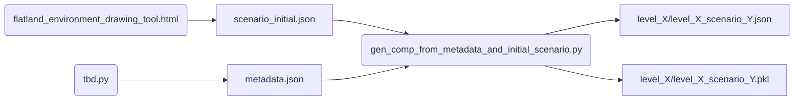
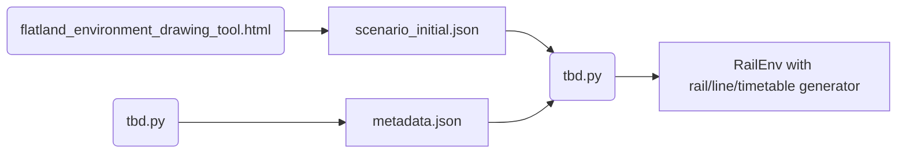

# Scenario generator

This is a tool to help you create Flatland environments and generate customized scenarios.

The examples folder contains 3 examples that were used as playground examples to test the drawing tool and
the [deadlock avoidance heuristic](https://github.com/flatland-association/flatland-baselines/tree/main/flatland_baselines/deadlock_avoidance_heuristic).

## Data Model and Data Flow

### Glossary

| Term             | Description                                                                                                                                                                                         |
|------------------|-----------------------------------------------------------------------------------------------------------------------------------------------------------------------------------------------------|
| Scenario         | Rail, lines, timetables and malfunction parameters fixed (each train has a set of stops with routing flexibility and a time window at each stop).                                                   |
| Initial Scenario | Defines timetables all starting at zero, malfunction usually empty.                                                                                                                                 |
| Metadata         | Defines the instantiation of the scenario from the initial scenario and timetable specs.                                                                                                            |
| Line             | A line is a sequence of stops with routing flexibility at intermediates and target but not initial (in strict Flatland sense, lines are agents with stops already assigned and max speeds as well). |
| Train Category   | Used to differentiate timetable specs for different train categories.                                                                                                                               |
| Timetable        | Corresponds to a Flatland agent with the stops to serve in given time-windows (Flatland Timetable).                                                                                                 |
| Scene            | A set of lines.                                                                                                                                                                                     |

### Data Model

```mermaid
classDiagram
  class metadata {
    TimetableSpecs defaults.timetableSpecs
    MalfunctionSpecs defaults.malfunctionSpecs
    MalfunctionSpecs defaults.departureMalfunctionSpecs
  }
  class scenario {
    TimetableSpecs timetableSpecs
    MalfunctionSpecs malfunctionSpecs
    MalfunctionSpecs departureMalfunctionSpecs
  }
  metadata "1" --> "1..*" level
  level "1" --> "1..*" scenario

  class TimetableSpecs {
    AttributeFilter attributeFilter
    TimetableTrainCategorySpecs trainCategories
    PostSampler postSampler
  }
  class TimetableTrainCategorySpecs {
    TimetableSpec IR
    TimetableSpec RE
    TimetableSpec S
    TimetableSpec C
  }
  class TimetableSpec {
    int initialShift
    int periodicity
    int times
    int travelFactor
  }
  class AttributeFilter {
    str key
    int | [int, int) val
  }
  class PostSampler {
    int num
  }
  class MalfunctionSpecs {
    int malfunction_duration_min
    int malfunction_duration_max
    int malfunction_interval
  }
  class Scenario {
    gridDimensions
    grid
    overpasses
    stations
    nextStationId
    lines
    timetables
    trainCategories
    flatlandLine
    flatlandTimetable
  }

```

### From Initial Scenario to Set of Scenarios



### From Initial Scenario to `RailEnv` (`reset` drawing from distribution in metadata)



## Drawing Tool

| workflow                                              |
|-------------------------------------------------------|
| [`Initialize grid`](#initialize-grid)                 |
| [`Draw grid-world`](#draw-grid-world)                 |
| [`Name stations and mark their areas`](#name-stations-and-mark-their-areas) |
| [`Create Lines`](#create-lines)                       |
| [`Define train categories`](#define-train-categories) |
| [`Create Timetables`](#create-timetables)             |
| [`Export environment`](#export-environment)           |

To turn an export into a Flatland `.pkl`, see [Build a scenario from a drawing and a config.json](#build-a-scenario-from-a-drawing-and-a-configjson).

### Initialize grid

Choose the number of rows and columns and how large they should be displayed on the screen. You can always resize both cell size and grid dimensions.

:warning: By shrinking the size of your grid you can delete parts of it (cannot be undone)!

You can also import previously exported JSON files which include both grid and cell size. You can use the *raw data import* at the bottom to only import the
grid, overpasses or stations.

### Draw grid-world

Use the **left mouse button to draw**, the **right mouse button to delete**. You can use your mouse or keyboard to alter, rotate or flip elements, define train
stations or overpasses.

Use the arrow keys to navigate on the grid and the keyboard shortcuts listed in the tool for more efficient drawing.

:bulb: Station-cells adjacent to each other have the same station-id, i.e. belong to the same station.

### Name stations and mark their areas

Stations keep their numeric id internally (lines and timetables refer to it). Select a station cell and press *Name Station* (D) to give it a name, e.g.
*Ziegelbrücke*. Names must be unique and must not contain `.`; an empty name goes back to the id. The export names a station by its name, else by its id.

Press *Station Area* (A) and drag a rectangle around a station, including its switches; the rectangle runs through the mid-points of its border cells.
The area must span at least two rows and two columns, contain all platform cells of exactly one station and must not overlap another station's area;
dragging again replaces it, *Remove Station Area* removes it. From the area the tool derives the station's gates
and pins and draws them:

- the station's **tracks** are the cells connected to its platforms by track inside the area, in either direction of travel, so passing loops off its
  switches count (tinted); a through track without a switch to the platforms inside the area is not part of the station
- a **pin** is a cell of the station's tracks where a track leaves the area
- a **gate** is a run of adjacent pins on one side, named by the side (`N`, `E`, `S`, `W`), or `E1`, `E2`, ... along the border when a side has several

An area that no longer fits its station (e.g. after editing the platforms) is drawn red, and the export refuses until it is fixed.

The export describes each station in the vocabulary of Flatland's
[stations and links](https://flatland-association.github.io/flatland-book/environment/environment/stations_links.html), with fully qualified names, plus
the tool's `id`, `area` and the `city_position`/`city_orientation` hints:

```json
{
  "id": 3, "name": "Ziegelbrücke", "city_position": [3, 4], "city_orientation": 1,
  "stopping_points": [{"name": "Ziegelbrücke.0", "node": [2, 4]}, {"name": "Ziegelbrücke.1", "node": [3, 4]}],
  "edges": [[2, 3], [2, 4], [2, 5], [3, 3], [3, 4], [3, 5], [4, 3], [4, 4], [4, 5]],
  "gates": {"W": {"name": "Ziegelbrücke.W", "pins": {"0": {"name": "Ziegelbrücke.W.0", "node": [2, 3]}, "1": {"name": "Ziegelbrücke.W.1", "node": [3, 3]}}},
            "E": {"name": "Ziegelbrücke.E", "pins": {"0": {"name": "Ziegelbrücke.E.0", "node": [2, 5]}, "1": {"name": "Ziegelbrücke.E.1", "node": [3, 5]}}}},
  "area": [2, 3, 4, 5]
}
```

An unnamed station is named by its id; without an area, its edges are its stopping points and it has no gates. The generated Flatland environment
(`env.stations_links`) takes these as they are. Links between stations are not derived yet. Older exports (`station_cells`) still import.

### Create Lines

To create Lines click the *Lines & Timetables* button. Each Line has

- a unique **name**
- an **ordered list of stations** (selected by clicking them on the map, shown with their ids and names)
- **start cell** and **end cell** (intermediate stations are identified through all corresponding cells to allow for the use of this flexibility)

Once a Line is created, you can display the shortest path lengths between the stations and the Line can be

- edited
- copied
- reversed
- deleted

### Define train categories

In order to choose what train is running your Lines you can create categories of trains whose parameters are a description of the category and its **maximum
speed**. There are 4 predefined train
categories.

### Create Timetables

To create Timetables click the *Lines & Timetables* button.

- give it a **name**
- select a **Line**
- select a **train class**
- choose the **travel factor** (this factor is multiplied with the length of the shortest path connecting to the subsequent station to add time flexibility)
- choose the **dwell time** [default: 2] (the dwell time is the number of time steps between the *latest arrival* and the *earliest departure* used in the
  automatic filling of the timetable)
- apply a **shift** to the whole timetable (this is mainly used when copying a Timetable to then shift the copy)

Timetables can be copied (and then shifted) within the drawing tool. However, to create scenarios with lots of shifted Timetables on the same lines, use
`generate_scenario.py` with your customized duplication function (see below).

### Export environment

Export your creation to save it or to use it when finished by clicking the *Export All (.json)* button.

You can use the *raw data import* at the bottom to only export the grid, overpasses or stations.

Click the *Flatland Download* button to download `flatland_import.py` to create the Flatland environment and save it as .pkl to then run your simulation. (If
you use `generate_scenario.py` to generate your scenario, do this before running `flatland_import.py`.)

## Build a scenario from a drawing and a config.json

`scenario_generator/model/config.py` turns a drawing-tool export and a small `config.json` into one scenario: the scenario `.json` and the Flatland
`.pkl` (`RailEnvPersister` format). Example `config.json`:

```json
{
  "malfunctions": {
    "scheduled": [
      {"train": "IC3", "step": 28, "duration": 12},
      {"handle": 2, "step": 40, "duration": 5}
    ]
  },
  "seed": 42
}
```

- **`malfunctions.scheduled`**: a train breaks down at `step` for `duration` steps. Name it by its timetable name in the tool (`train`) or by its
  handle (`handle`, the timetable's position in the tool, from 0).
- **`malfunctions.breakdown`** / **`malfunctions.departure`** (optional): random malfunctions,
  `{"malfunction_interval": 540, "malfunction_duration_min": 20, "malfunction_duration_max": 50}`. Leave them out for a reproducible scenario.
- **`timetableSpecs`** (optional): generate the timetables as in `metadata.json`; without it the tool's timetables are taken as they are.
- **`seed`** (optional).

Run from the repository root:

```shell
PYTHONPATH=. python -m scenario_generator.model.config drawn_environment_export.json config.json my_scenario --output-folder out
```

This writes `out/my_scenario.json` and `out/my_scenario.pkl`. Add `--no-pkl` to write only the `.json`.

## Generate scenario

Use the `generate_scenario.py` script to duplicate the initial Timetables to create a complete timetable:

- the **initial_shift** defines the first *earliest departure*
- the **shift** defines the shift from one Timetable to the next
- **times** defines how many times the Timetable should be created (it is technically not copied, so `times=1` results in only one Timetable)

Using this method you only need to create each unique Timetables once in the drawing tool.

:warning: To use this script without much customization, name your timetables *XY 1.1*, *XY 2.1*, etc. (e.g. *IC 1.1*, *IC 2.1*, *RE 1.1*, *RE 2.1*).
